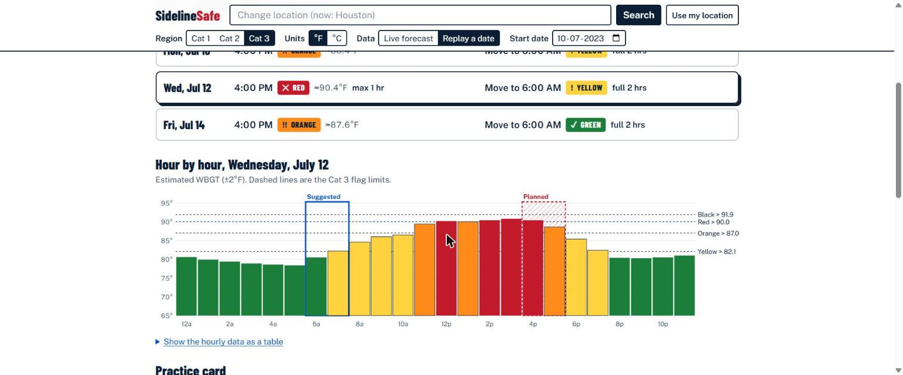
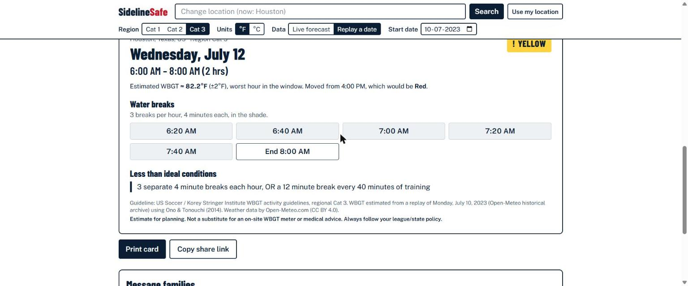
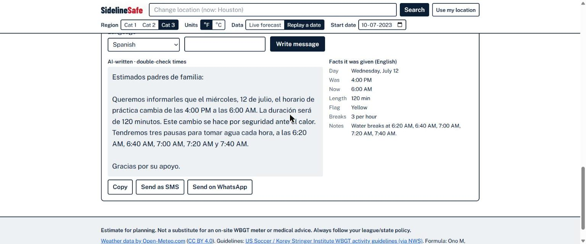
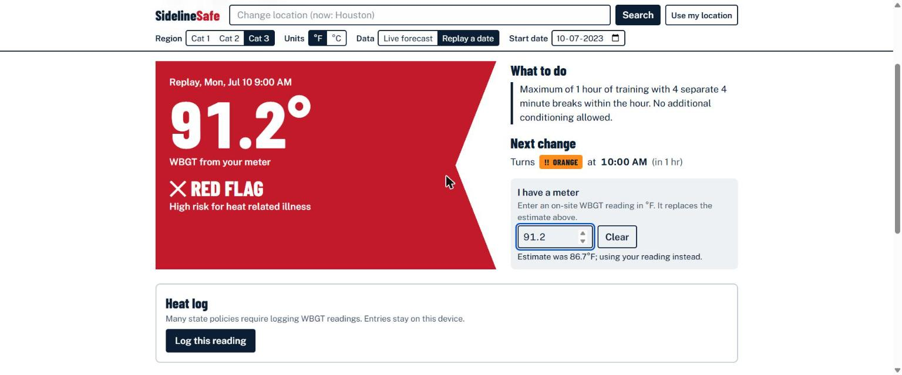
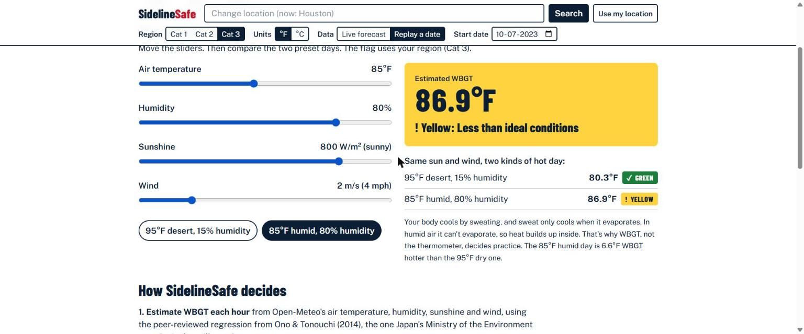
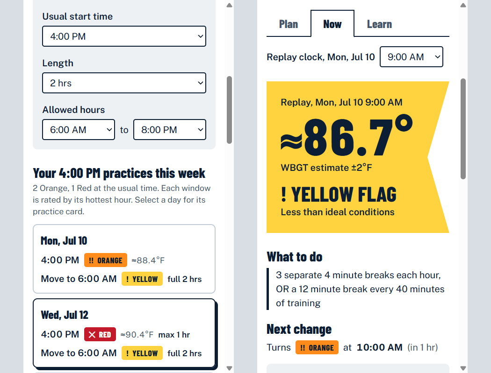

# SidelineSafe

**The heat-safety practice planner for teams without an athletic trainer.**
Don't just read the heat. Plan around it.

**Live:** https://sidelinesafe.deployxa.online · Deployed on [Deployxa](https://deployxa.com)
**Try the demo week:** [Houston, July 2023 replay](https://sidelinesafe.deployxa.online/?name=Houston%2C+Texas%2C+US&lat=29.763&lon=-95.363&cat=3&src=replay&date=2023-07-10&tab=plan)



## The problem

- **Exertional heat stroke is a leading cause of death in US secondary-school sport**, and the top cause in summer months ([Sports Health 2024, PMC11635796](https://pmc.ncbi.nlm.nih.gov/articles/PMC11635796/); [Korey Stringer Institute](https://koreystringer.institute.uconn.edu/wet-bulb-globe-temperature-monitoring)).
- **About 34% of US secondary schools with athletics have no athletic trainer** ([same study](https://pmc.ncbi.nlm.nih.gov/articles/PMC11635796/)). Youth rec leagues, camps and marching bands usually have nobody qualified at all.
- These deaths are **almost always preventable** when practice is modified by **WBGT** (Wet Bulb Globe Temperature), a heat-stress index that combines air temperature, humidity, sun and wind. The US Soccer / KSI regional guidelines say exactly what to do at each WBGT level.
- **The gap:**
  - A WBGT meter costs hundreds of dollars and only reads *right now*.
  - Practices are scheduled days ahead by volunteer coaches who don't know the guidelines.
  - Families get no warning.

## What it does

Coach Maria runs a volunteer U14 soccer team in Houston. There's no trainer, and practice is Mon/Wed/Fri at 4 PM. She types her city and schedule:

| Tab | What it does |
|---|---|
| **Plan** | Shows the flag of every practice this week at its usual time, rated by its **hottest hour**. Finds the **safest window** each day and applies the guideline's time cap (Orange 2 h, Red 1 h, Black cancel). Produces a **printable practice card** with water breaks as real clock times. The page URL *is* the plan (share link, no account). **Message families** writes a short note in 10 languages. |
| **Now** | Big current flag, when it next changes, and what to do. An **"I have a meter"** override, and a **heat log** (localStorage, CSV export) because many state policies require logging readings. |
| **Learn** | Sliders for temperature, humidity, sun and wind. Shows why **85°F at 80% humidity (86.9°F WBGT) is more dangerous than 95°F at 15% (80.3°F)**. Also covers the formula, the guideline table, and how the planner decides. |

Headline result (real archive data, Houston, Wed 12 Jul 2023, Cat 3):
**4:00 PM → ✕ RED, ≈90.4°F WBGT (max 1 hr). Move to 6:00 AM → ! YELLOW, full 2 hrs. Water breaks at 6:20, 6:40, 7:00, 7:20, 7:40 AM.**

| | |
|---|---|
|  |  |
|  |  |



## How it works

```
Browser (Next.js client page)
  ├─ Open-Meteo geocoding / forecast / archive   (client fetch, no key)
  ├─ lib/wbgt.ts     pure functions: WBGT estimate, flags, planner, breaks   ← all safety logic
  └─ POST /api/brief → Claude (server-side key)   ← wording only, with template fallback
```

**1. WBGT estimate.** Ono & Tonouchi (2014) regression, Eq. 3. This is the formula Japan's Ministry of the Environment uses for its heat-illness estimates:

```
WBGT(°C) = 0.735·Ta + 0.0374·RH + 0.00292·Ta·RH + 7.619·SR − 4.557·SR² − 0.0572·WS − 4.064
Ta °C · RH % · SR global solar radiation kW/m² · WS wind m/s
```

- Coefficients were verified against the paper PDF ([J-STAGE](https://www.jstage.jst.go.jp/article/seikisho/50/4/50_147/_article/-char/en), doi:10.11227/seikisho.50.147) and [wbgt.env.go.jp](https://www.wbgt.env.go.jp/wbgt_detail.php).
- Reported error is within ±1 °C for 97–99.8% of hours, so the UI shows `≈ X°F (±2°F)`.
- Inputs come hourly from Open-Meteo: `temperature_2m, relative_humidity_2m, wind_speed_10m, shortwave_radiation` (W/m² ÷ 1000).
- SR is clamped to the quadratic's peak (0.836 kW/m²) so more sun never lowers the estimate. This is conservative, ≤0.12 °C.
- `CAL_OFFSET_F` is a calibration knob for local meter data.

**2. Flags.** These are the [US Soccer / KSI regional guidelines](https://www.weather.gov/arx/wbgt), copied verbatim, including the action text:

| Flag | Cat 1 °F | Cat 2 °F | Cat 3 °F | Max time | Breaks |
|---|---|---|---|---|---|
| ✓ Green | ≤ 76.1 | ≤ 79.8 | ≤ 82.1 | – | 3 × 3 min / hr |
| ! Yellow | 76.2–81.0 | 79.9–84.6 | 82.2–87.0 | – | 3 × 4 min / hr |
| !! Orange | 81.1–84.1 | 84.7–87.7 | 87.1–90.0 | 2 h | 4 × 4 min / hr |
| ✕ Red | 84.2–86.1 | 87.8–89.7 | 90.1–91.9 | 1 h | 4 × 4 min / hr |
| ⛔ Black | > 86.2 | > 89.8 | > 92.0 | cancel | – |

WBGT is rounded to 0.1°F, then compared with `<=` against each upper bound. The default region is Cat 1 (most protective) until the user picks one.

**3. Planner** (`planDay`):
- For each practice day, rate the usual time and every on-the-hour window in the allowed hours by the **worst** hour it covers. We use the worst hour, not the average, because it's the safety-conservative choice.
- Pick the lowest. Ties go to the time closest to the usual start.
- If the usual time is already in that lowest flag, keep it.
- Cap the duration by the window's flag, then space water breaks evenly (`breakTimes`).

**4. Family message.** `POST /api/brief` sends **only the planner's facts** to Claude Haiku 5.5 ("copy every time and number exactly; no medical advice").
- Body ≤ 2 KB, and the language must be on the allowlist.
- If the reply doesn't contain every clock time verbatim, or there's no key, or the API fails, it returns a deterministic English template.
- The UI labels AI text "AI-written · double-check times" and shows the English facts beside it.

*Safety decisions are deterministic, tested and cited. AI only does what it's good at: language.*

**Tested:** `node lib/wbgt.check.ts` asserts the following:
- every flag boundary for all 3 regions, including edge values
- monotonicity in temperature, humidity, sun and wind
- humid 85°F/80% > dry 95°F/15%
- the planner choosing the minimum-risk window, Red capping 120→60 min, Black cancelling, and an already-Green practice being kept
- break clock times
- the next flag change
- the message template

## What's original vs. existing WBGT apps

Free WBGT apps (HeatSafe, Klimo, HeatGuard) and paid tools (Zelus, Perry Weather) answer **"how hot is it right now, for me?"** SidelineSafe answers **"when should my team practice this week, and what exactly do we do then?"**:

1. **Forecast-driven scheduling.** It flags Red/Black practices days ahead and finds the safest window.
2. **Guideline → action plan.** You get a time cap and actual water-break clock times on a printable card.
3. **Family communication** in the parents' language. The safety facts are fixed; only the wording is AI.
4. **Free and global.** No meter, no account; the plan lives in a share link. A meter reading overrides the estimate.

## Run it

```bash
npm install
cp .env.example .env.local   # optional: add ANTHROPIC_API_KEY for AI messages
npm run dev                  # http://localhost:3000
node lib/wbgt.check.ts       # self-check (Node ≥ 22.18, native TypeScript)
npm run lint && npm run build
```

Without `ANTHROPIC_API_KEY`, everything works and family messages use the English template. Stack: Next.js (App Router) + TypeScript + Tailwind, with **no other dependencies**. The chart is hand-written SVG, and the Claude call is plain `fetch`.

## Limits and next steps

- **Limits:**
  - It's a regression estimate (±2°F). It isn't calibrated against on-field meters yet.
  - Hourly steps.
  - The Cat 1/2/3 regions are US-defined; elsewhere, pick by climate.
- **Next steps:** push/SMS sending, team rosters, the 14-day heat-acclimatization tracker, lightning and AQI, and calibration with school meter data.

> Estimate for planning. Not a substitute for an on-site WBGT meter or medical advice. Always follow your league/state policy.

## AI and third-party disclosure

- **Claude Code** helped write the code.
- **The Claude API** (Claude Haiku 5.5) writes the family messages. In the test setup it's reached through OpenRouter's Anthropic-compatible endpoint.
- **Weather data by [Open-Meteo.com](https://open-meteo.com/)** (CC BY 4.0).
- **Guidelines** from US Soccer and the Korey Stringer Institute (via NWS).
- **WBGT formula:** Ono M, Tonouchi M. *Estimation of wet-bulb globe temperature using generally measured meteorological indices.* Jpn J Biometeorol. 2014;50(4):147–157.
- Built with **Next.js**. Fonts: Barlow Condensed and Public Sans (Google Fonts, OFL).
